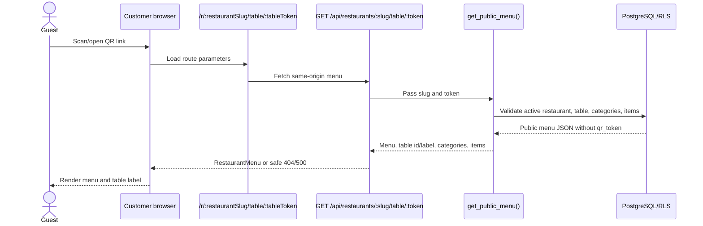
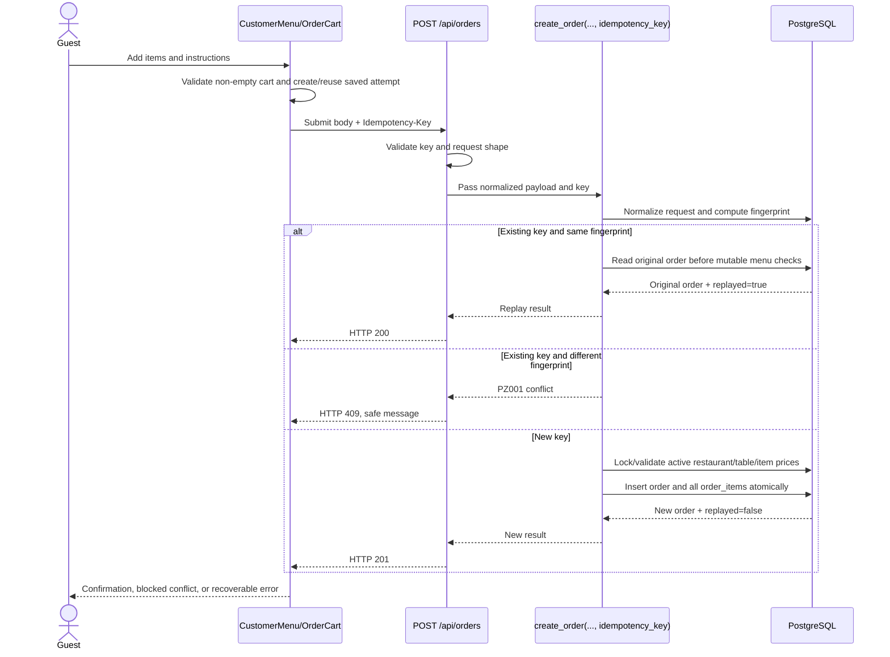
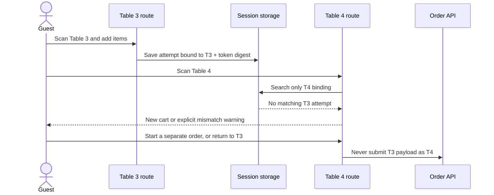
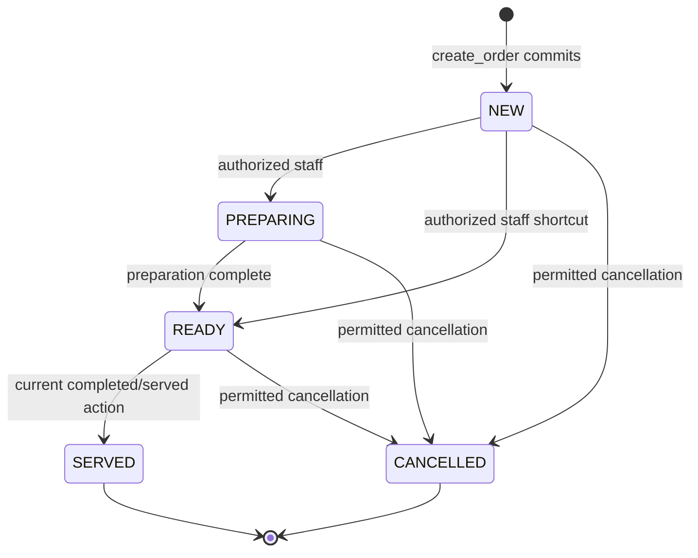
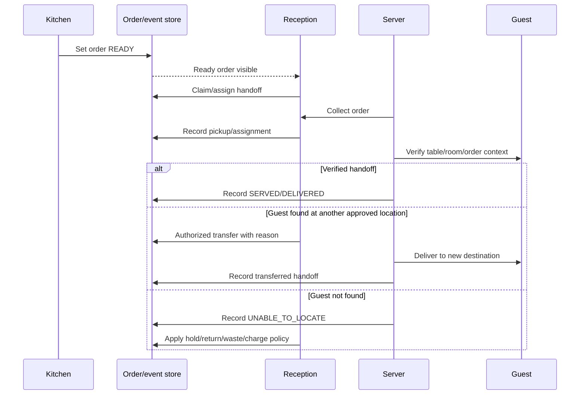
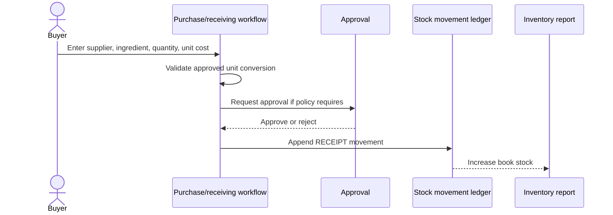
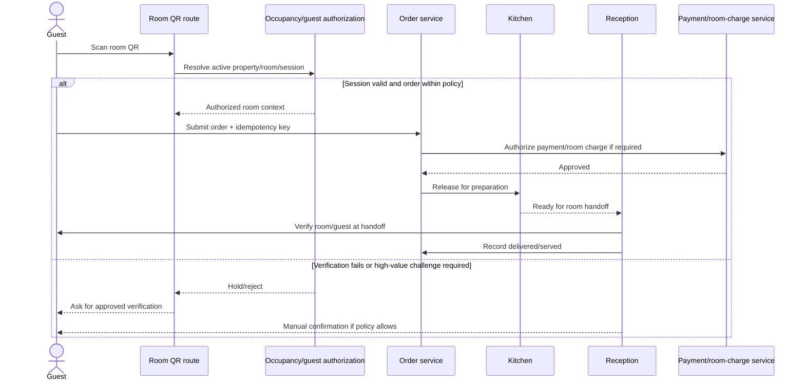
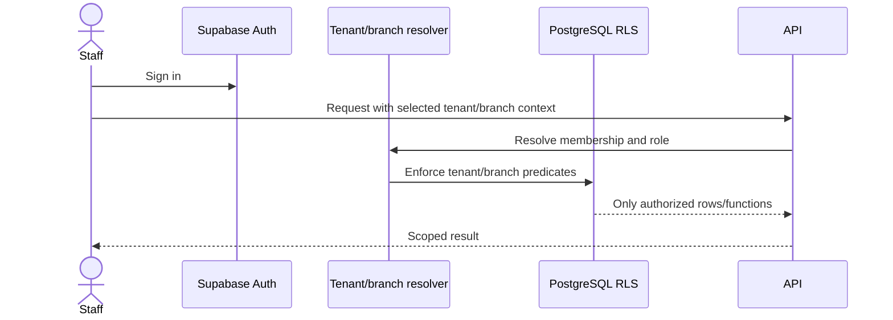

# Altiora Workflows and State Machines

**Phase:** Product Definition and Requirements Engineering
**Document status:** Implementation-ready workflow specification; documentation only
**Evidence rule:** “Current” means verified in the local repository. “Planned,”
“decision-dependent,” and “database-unverified” are intentionally separate.

## 0. Workflow conventions

### 0.1 Current versus target behavior

The local repository currently supports a restaurant/table QR menu, cart, order
submission, kitchen/reception dashboards, staff authentication, and a local
idempotency/recovery implementation. It does not yet prove the new database
contract at runtime, and it does not contain the hotel, inventory, handoff,
QR-administration, or audit modules described as future requirements.

### 0.2 Actors

```text
Guest                 Unauthenticated customer using a public QR link
Kitchen staff         Staff member preparing food
Reception             Front-of-house/service coordinator
Server/delivery       Staff member performing handoff
Manager/owner         Tenant operator and approver
Inventory staff       Future stock/procurement operator
Platform admin        Future SaaS support/operator role
System                Next.js routes, Supabase Auth, PostgreSQL/RLS/RPCs
```

### 0.3 Current verified order statuses

The local database enum is:

```text
NEW, PREPARING, READY, SERVED, CANCELLED
```

The local dashboard maps `SERVED` to the UI value `completed`. The dashboard
does not show `CANCELLED` in its visible list because the API filters it out.
The local transition helper and database trigger allow:

```text
NEW       -> PREPARING | READY | CANCELLED
PREPARING -> READY     | CANCELLED
READY     -> SERVED    | CANCELLED
SERVED    -> terminal
CANCELLED -> terminal
```

Same-status updates are treated as idempotent by the local helper. PostgreSQL
execution of the trigger, RLS, and concurrent behavior remains
**BLOCKED BY VERIFICATION**.

## 1. Current route and API sequence

### 1.1 Public customer route



**Current evidence:** `app/r/[restaurantSlug]/table/[tableToken]/page.tsx`,
`app/api/restaurants/[restaurantSlug]/table/[tableToken]/route.ts`, and
`components/customer-menu.tsx`.

**Required invariants**

- The restaurant slug and QR token must resolve to the same active tenant and
  active service point.
- The public response must not contain the stored `qr_token`.
- An invalid/inactive/revoked token returns a safe unavailable response and
  does not reveal another tenant or service point.
- A static QR is only a locator. It is not proof of physical presence or guest
  authorization.

### 1.2 Current order-submission sequence



**Current response contract**

| Situation | Current API response | Customer behavior |
| --- | --- | --- |
| New committed order | `201`, order id/number/status/total/timestamp, `replayed: false` | Clear saved attempt and show confirmation. |
| Same key and same normalized payload | `200`, original order, `replayed: true` | Treat as the original success; do not insert again. |
| Same key and different payload | `409`, safe conflict message | Mark attempt `conflict`; do not retry or mutate it; require explicit start-over. |
| Malformed/missing key or definite validation error | `400` | Clear only the rejected attempt and leave the cart editable, where safe. |
| Network/5xx/408/429 | Error/uncertain | Preserve exact payload/key and offer explicit retry. |

The API also accepts the prior camel-case request shape as a compatibility
adapter. The canonical current request is snake_case. This compatibility must
remain until a deliberate API version change is approved.

## 2. Customer order lifecycle

### 2.1 State model

The customer-facing lifecycle is broader than the current database enum:

```text
QR_OPENED
    -> SERVICE_POINT_RESOLVED
    -> MENU_VIEWING
    -> CART_EDITING
    -> SUBMISSION_PENDING
    -> ORDER_CONFIRMED
    -> KITCHEN_PROCESSING
    -> READY_FOR_HANDOFF
    -> HANDOFF_IN_PROGRESS
    -> SERVED_OR_DELIVERED

Any applicable state may also produce:
    -> CANCEL_REQUESTED
    -> CANCELLED_BEFORE_PREP
    -> CANCELLED_AFTER_PREP
    -> UNABLE_TO_LOCATE
    -> RETURNED
    -> WASTED
    -> FAILED_VERIFICATION (hotel only)
```

Only `NEW`, `PREPARING`, `READY`, `SERVED`, and `CANCELLED` are current local
database states. The other names are workflow events/states that require an
approved model before implementation.

### 2.2 Detailed workflow

1. **QR scan**
   - The guest opens `/r/[restaurantSlug]/table/[tableToken]`.
   - The system resolves the token through the public menu RPC.
   - If resolution fails, the guest sees an unavailable/expired-link state.

2. **Service-point resolution**
   - The browser receives a public table/service-point id and human label.
   - It does not receive `qr_token` from the menu response.
   - The server retains the authoritative tenant/table relationship.

3. **Menu viewing**
   - Only active categories/items are displayed by the current RPC.
   - The browser may show prices and availability, but the database remains the
     source of truth at submission.

4. **Cart editing**
   - The cart accepts one row per menu item, integer quantities, and bounded
     instructions.
   - An unavailable item cannot be added by the current UI, but the server must
     recheck availability because menu state may change after loading.

5. **Submission pending**
   - A new submission creates an opaque idempotency key and saves a v3 attempt
     bound to the restaurant/table.
   - A double-click is blocked while the request is in flight.
   - The same attempt/key is reused after uncertain outcomes.

6. **Order confirmation**
   - On `201` or matching replay `200`, the browser clears the saved attempt and
     shows the order number/reference.
   - The current UI does not provide public live tracking after confirmation.

7. **Kitchen processing**
   - The order appears in the staff dashboard as `new`, then may be advanced by
     authorized staff.
   - The dashboard currently refreshes once on load and every 30 seconds. It
     also exposes a manual refresh.

8. **Ready and handoff**
   - The current database can reach `READY`, but a separate handoff proof is not
     currently stored.
   - A production-ready workflow must distinguish ready from served/delivered.

9. **Completion, cancellation, or exception**
   - `SERVED` is the current terminal success state.
   - `CANCELLED` is terminal in the current state machine but lacks a reason and
     audit-history model.
   - Unable-to-locate, return, waste, and post-preparation cancellation require
     separate events before they are represented as product capabilities.

## 3. Idempotency and recovery state machine

### 3.1 Current client attempt states

```text
NO_SAVED_ATTEMPT
    -> ACTIVE (new key and editable cart)
    -> UNCERTAIN (transport/server outcome not known)
    -> CONFIRMED (clear local attempt)
    -> CONFLICT (same key used for different request)
    -> LEGACY_BLOCKED (old record cannot be safely identified)

UNCERTAIN -> explicit retry with same key and same payload
UNCERTAIN -> explicit abandon and new order
CONFLICT -> explicit abandon only; never automatic retry with same key
LEGACY_BLOCKED -> return to original link or explicit abandon
```

### 3.2 Persistence rules

- Current v3 records persist the idempotency key, normalized request payload,
  restaurant scope, public table id when available, and a SHA-256 table-token
  digest. The raw table token is omitted.
- A valid v3 record restores as `uncertain` after reload, except a recorded
  conflict remains `conflict`.
- A stored attempt for Table 3 is not adopted by Table 4.
- A rotated token does not prove the saved request's original identity and must
  not silently restore the attempt.
- Recognizable v1/v2 legacy records are preserved. Safe v2 token-digest records
  may restore; v1, raw-token, missing-binding, invalid-binding, invalid-identity,
  and invalid-payload records are blocked until explicit abandonment.

### 3.3 Recovery acceptance tests

- Reload after a timeout shows the saved order and offers retry using the same
  key.
- Refresh after a committed order but lost response replays the same order.
- Reusing a key with changed quantity, table, restaurant, or instructions shows
  a conflict and never inserts another order.
- A legacy record is not silently deleted, rewritten, or resubmitted.
- “Start over and edit order” removes only the selected attempt/legacy record,
  not another table's saved attempt under the same restaurant.

## 4. Table-switch workflow and QR lifecycle

### 4.1 Scenario A — Table 3 to Table 4 before submission



**Preventive controls**

1. Use service-point-scoped storage keys and a token digest.
2. Check both restaurant and service-point binding before restoration.
3. Clear active in-memory route references synchronously when route params
   change, so a late callback cannot submit against the new route.
4. Require explicit abandonment before replacing a conflict or unsafe legacy
   attempt.

**Detection and recovery**

- Show a saved-checkout mismatch without exposing the other table's secret.
- Let the guest return to the original route or explicitly start over.
- Let reception assist with a committed-order transfer; do not mutate the
  original order destination in the customer browser.

### 4.2 QR token replacement

The target QR administration workflow is:

```text
Owner/manager requests rotation
    -> confirm service point and reason
    -> generate new random token
    -> atomically mark old token revoked/replaced
    -> issue preview/print artifact
    -> record audit event
    -> old token fails public resolution
```

The grace-period question is unresolved. The default security recommendation is
immediate invalidation for a replacement, with an explicitly approved short
grace period only when printed material cannot be replaced safely. Historical
orders retain the service-point id/label; they do not depend on the new token.

### 4.3 QR requirements

- Human label and secret token are separate fields.
- Labels may be arbitrary strings and unique only in the approved branch scope.
- QR preview/print artifacts must not reveal internal database ids unless the
  approved format requires them.
- Audit data may store a one-way token digest or key id, never the raw token.
- A QR link does not prove the scanner is physically at the table or in the
  hotel room.

## 5. Kitchen state machine

### 5.1 Current state machine



**Verified current implementation**

- `lib/orders/status.ts` contains the local transition helper.
- The initial migration defines a PostgreSQL status-transition trigger.
- `PATCH /api/orders/:orderId/status` accepts `new`, `preparing`, `ready`,
  `completed`, and `cancelled`, mapping `completed` to database `SERVED`.
- The API first reads the current order, checks the local transition helper,
  then updates only `status`.
- The database trigger is intended to be the final guard.
- The dashboard performs optimistic status display, rolls back on request
  failure, and refreshes after a successful update.

**Verification limitation:** The route/API tests mock the RPC order route but do
not prove the status route against PostgreSQL RLS/triggers. The SQL assertions
have not executed in this workspace.

### 5.2 Kitchen workflow

1. `NEW` order appears in the tenant's dashboard with order number, table
   label, items, quantities, instructions, total, and received time.
2. Kitchen staff accepts the order and moves it to `PREPARING`.
3. Kitchen staff prepares each item and records a shortage or failure through a
   future exception action rather than changing item quantity silently.
4. Kitchen staff moves the order to `READY`.
5. A server/reception workflow claims the ready order and records handoff.
6. The order becomes `SERVED` only after the approved service confirmation.

The current implementation does not store preparation-start or ready timestamps
as a separate event history, so true preparation-time reporting is not yet
available. `updated_at` alone must not be used as a substitute when an order can
have multiple status changes.

### 5.3 Status permissions

Target permission policy:

| Transition/action | Kitchen | Reception | Server | Manager/owner |
| --- | --- | --- | --- | --- |
| `NEW -> PREPARING` | Yes | Optional escalation | No | Yes |
| `PREPARING -> READY` | Yes | No | No | Yes |
| `READY -> SERVED` | No, unless delegated | Optional | Yes after handoff | Yes |
| Cancel before preparation | Policy-dependent | Request/approve | No | Yes |
| Cancel after preparation | Request only | Request/approve | Report exception | Yes/approved delegate |
| Change price/table/items | No | No | No | Separate approved workflow |

The current repository does not have these separate roles or policies. Current
RLS/API behavior should therefore be treated as **PARTIALLY IMPLEMENTED** and a
P0 authorization item, not as proof that every authenticated staff user may
perform every status action.

### 5.4 Repeated and concurrent actions

- Same-status updates should return success without duplicating an audit event.
- A transition racing with another transition must be checked against the
  database's current row, not only a stale dashboard copy.
- A forbidden transition must leave the row unchanged and return a conflict or
  safe validation response.
- The UI must reload/reconcile after a concurrent update instead of overwriting
  a newer state with an optimistic stale value.
- Every successful transition should eventually create one audit event with
  actor, previous state, next state, reason, and timestamp.

### 5.5 Refresh behavior

The current `KitchenDashboard` has one `setInterval` loop at 30 seconds and a
manual refresh button. It also shows the last update time and a non-blocking
refresh error after data has already loaded. Future realtime work must replace or
coordinate with this loop; it must not add a second polling loop.

## 6. Reception and service handoff

### 6.1 Current behavior

`/reception` invokes the same `KitchenDashboard` component in `reception` mode.
The mode changes labels, but the current API data, filters, status controls, and
visible orders are shared. There is no distinct handoff record, assignment,
transfer, guest verification, or cancellation queue.

Classification: **PARTIALLY IMPLEMENTED**.

### 6.2 Target reception workflow



### 6.3 Required handoff record

The target model should record, at minimum:

- order id and original tenant/service point;
- ready timestamp and pickup/claim timestamp;
- assigned staff identity/team;
- destination verification method and result;
- transfer destination and reason, if any;
- served/delivered, unable-to-locate, returned, wasted, or failed result;
- cancellation/charge/refund decision where applicable; and
- audit correlation id.

The exact table/event schema is **PLANNED**; do not infer it from current
`orders.updated_at`.

## 7. Cancellation and exception workflows

### 7.1 Cancellation decision tree

```text
Cancellation request
    |
    +-- order is NEW and preparation not started?
    |       -> cancel-before-preparation policy
    |
    +-- order is PREPARING?
    |       -> manager/approved cancellation policy
    |       -> record consumed/prepared/wasted disposition
    |
    +-- order is READY?
    |       -> service exception or cancellation policy
    |       -> record prepared-food disposition
    |
    +-- order is SERVED?
    |       -> no state reversal; use refund/complaint/return workflow
    |
    +-- order is already CANCELLED?
            -> idempotent response; no duplicate movement
```

### 7.2 Required distinctions

| Event | Can change current order status? | Required follow-up |
| --- | --- | --- |
| Customer cancellation before prep | Usually `NEW -> CANCELLED` | Release reservation if one exists; no expected consumption. |
| Kitchen cancellation after prep starts | Usually `PREPARING -> CANCELLED` only with permission | Reason, item/food disposition, possible wastage. |
| Guest cannot be located | Not automatically a cancellation | Handoff exception, contact attempt, hold/return/waste/charge decision. |
| Food returned | Not automatically a status regression | Quality check and a separate return movement. |
| Complaint after served | No `SERVED -> CANCELLED` transition | Refund/credit/complaint workflow with approval. |

### 7.3 Current limitation

The current database has only `CANCELLED` and no cancellation reason, actor,
event history, handoff, payment, refund, return, or waste entities. The target
workflow must not be represented by simply adding more UI labels without a
durable audit/event design.

## 8. Inventory and recipe accounting workflow

Inventory is a future append-only movement system. It must not be implemented as
a freely editable current-stock number.

### 8.1 Target entities (proposed, not current schema)

```text
tenant / branch
  ├── ingredients
  ├── units and approved conversions
  ├── suppliers
  ├── purchase_receipts
  │     └── purchase_receipt_lines
  ├── recipes
  │     └── recipe_versions
  │           └── recipe_ingredients
  ├── stock_movements
  ├── inventory_counts
  │     └── inventory_count_lines
  ├── wastage/adjustment approvals
  └── order_consumption_events
        └── order_consumption_lines
```

These are probable entities for design discussion, not a request to add them
now. Ownership must be explicit at tenant and branch scope.

### 8.2 Purchase/receiving flow



Stock increases only after a valid receiving movement. Editing a supplier or
current price must not rewrite historical receipt quantities/costs.

### 8.3 Recipe workflow

1. Owner/manager creates a draft recipe version for a menu item and portion.
2. Ingredient quantities use approved standard units.
3. An approver publishes the version with an effective timestamp.
4. Future qualifying orders use the effective recipe version.
5. Historical consumption remains linked to the version used at the selected
   event time.
6. A recipe change creates a new version; it never silently rewrites prior
   consumption.

### 8.4 Order-linked expected consumption

Recommended flow, pending the inventory deduction decision:

```text
Qualifying order event
    -> resolve effective recipe version
    -> calculate expected ingredient quantities
    -> create one idempotent consumption event per order/order-item/version
    -> append EXPECTED_CONSUMPTION movements
    -> expose calculated stock and variance
```

Example:

```text
Opening receipt: 10 kg paneer = 10,000 g
Recipe: 180 g per Paneer Tikka portion
Order: 3 portions
Expected consumption: 180 × 3 = 540 g
Calculated remaining: 10,000 - 540 = 9,460 g
```

This is expected recipe consumption, not proof of exact physical usage. Actual
usage may differ because of trimming, over-portioning, spoilage, returns,
substitutions, count error, or other movements.

### 8.5 Wastage, return, and adjustment flow

```text
Observed event
    -> choose movement type (WASTAGE, SPOILAGE, RETURN, CORRECTION, COUNT)
    -> enter quantity, unit, reason, actor, source reference
    -> require approval for unusual/high-value adjustment
    -> append movement; never erase prior movement
    -> recalculate book stock and variance
```

An adjustment changes the book position but does not rewrite the order's
expected consumption. A physical count creates evidence about variance; it does
not prove intent or theft.

## 9. Hotel room-service workflow

### 9.1 Scope status

Hotel room service is **PLANNED / DECISION REQUIRED**. The current repository
has table-scoped restaurant ordering only. `Room 1001` is a valid future label
example, not an implemented room entity.

### 9.2 Target room flow



### 9.3 Required controls before implementation

- current occupancy and check-in state;
- guest/session identity or approved room PIN/app session;
- high-value order threshold and step-up authentication;
- payment versus room-charge policy;
- staff confirmation and override policy;
- checked-out/empty-room handling;
- abuse logging and investigation; and
- PMS/housekeeping integration boundary, if any.

## 10. Multi-tenant and multi-branch workflow

### 10.1 Current limitation

The current schema owns data directly by `restaurant_id`. A user may have more
than one membership, but `getStaffAccess()` chooses a valid active restaurant
for the current dashboard request rather than exposing a tenant/branch switcher.
This is adequate for the current demo shape but is not a complete SaaS
hierarchy.

### 10.2 Target access sequence



A future branch model must decide whether `restaurant` means tenant, property,
branch, or a user-facing business. Until then, all proposed child entities must
carry the ownership relationship explicitly and must not infer it from a label
or QR token.

## 11. Verification matrix

| Workflow | Unit/helper evidence | API evidence | PostgreSQL/RLS evidence | Browser/manual evidence | Current classification |
| --- | --- | --- | --- | --- | --- |
| Public menu resolution | Partial | Route implementation exists | RPC/policy SQL exists but not executed | User previously tested menu loading | **BUILT / PREVIOUSLY TESTED; BLOCKED BY VERIFICATION** |
| New order creation | Validation and API mock tests | `POST /api/orders` tests | Atomic RPC tests written, not executed | Earlier contract was user-tested | **IMPLEMENTED LOCALLY / DATABASE-UNVERIFIED** |
| Same-key replay/conflict | Idempotency helper/API tests | Mocked `200/409` responses | Replay/concurrency SQL written, not executed | Reload/double-click E2E absent | **IMPLEMENTED LOCALLY / DATABASE-UNVERIFIED** |
| Table switching | Idempotency helper tests | No dedicated browser E2E | Token/table binding in RPC design | Manual route-switch test required | **IMPLEMENTED LOCALLY / DATABASE-UNVERIFIED** |
| Kitchen status flow | Local transition helper tests | Status route exists | Trigger/RLS SQL written, not executed | User previously saw updates | **BUILT / PREVIOUSLY TESTED; BLOCKED BY VERIFICATION** |
| Reception handoff | None beyond shared dashboard | No handoff API | No handoff schema | No dedicated manual flow | **PLANNED / PARTIALLY IMPLEMENTED** |
| Staff login/membership | Redirect/password helper tests | Dashboard API checks | Membership RLS written, not executed | User previously tested login | **BUILT / PREVIOUSLY TESTED; BLOCKED BY VERIFICATION** |
| Inventory/recipe consumption | None | None | No schema | No manual flow | **PLANNED** |
| Room service authorization | None | None | No room/occupancy schema | No manual flow | **DECISION REQUIRED** |

## 12. Operational runbooks required before release

The following runbooks are part of the product workflow, not optional support
notes:

1. **QR replacement:** identify service point, approve reason, rotate, print,
   verify old token fails, verify new token works, and record audit evidence.
2. **Lost order response:** search by order id/number and idempotency correlation
   metadata without exposing secrets; determine whether the order committed;
   never create a replacement order until the original outcome is known.
3. **Table transfer:** preserve original table, record the new destination and
   reason, and communicate the transfer to kitchen/service staff.
4. **Unable to locate:** record contact attempts, hold/return/waste/charge
   disposition, and the responsible staff member.
5. **Post-preparation cancellation:** require policy-approved reason, record food
   disposition, and create any inventory/waste movement.
6. **Membership revocation:** revoke membership, invalidate or recheck sessions,
   verify dashboard/API denial, and retain the audit event.
7. **Database contract verification:** apply only in a disposable/local
   environment, run migrations and `supabase test db`, run concurrent tests,
   compare RPC signatures, and record the exact revision tested. This runbook
   was not executed for this documentation task.

## 13. Evidence files

The workflow specification was derived from:

- `app/api/restaurants/[restaurantSlug]/table/[tableToken]/route.ts`
- `app/api/orders/route.ts`
- `app/api/orders/[orderId]/status/route.ts`
- `app/api/kitchen/dashboard/route.ts`
- `app/r/[restaurantSlug]/table/[tableToken]/page.tsx`
- `components/customer-menu.tsx`
- `components/order-cart.tsx`
- `components/kitchen-dashboard.tsx`
- `lib/data.ts`
- `lib/orders/status.ts`
- `lib/orders/validation.ts`
- `lib/orders/idempotency.ts`
- `lib/staff/auth.ts`
- `middleware.ts`
- `supabase/migrations/20261018000000_altiora_mvp.sql`
- `supabase/migrations/20261019000000_fix_order_number_ambiguity.sql`
- `supabase/migrations/20261020000000_order_idempotency.sql`
- `supabase/migrations/20261020010000_order_idempotency_hardening.sql`
- `supabase/tests/rls.sql`
- `supabase/tests/order_rpc.sql`
- `app/api/orders/route.test.ts`
- `lib/orders/idempotency.test.ts`

No source, test, migration, schema, configuration, README, credential, or
remote-database file was changed to produce this document.
